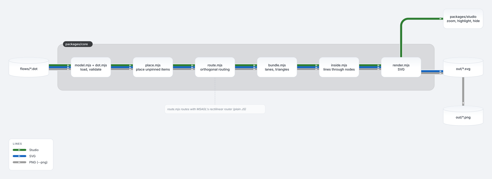

# Developing linemap

Needs Node 22 or later and pnpm.

```sh
git clone https://github.com/mergezalot/linemap.git && cd linemap
pnpm install       # also bundles MSAGL into packages/core/vendor/
pnpm example       # redraws examples/*.svg, docs/pipeline.svg and the studio screenshot docs/studio.png
pnpm export [flow.dot ...] [-o out.svg|out.html] [options]   # linemap export, from the sources
pnpm studio [dir] [--port n] [--open]   # linemap studio, the page rebuilt when its sources change
pnpm build         # the studio page, packages/studio/dist/linemap.html, which export fills
pnpm test          # builds the studio, then core and CLI (node:test): errors, rendering, the committed SVGs, the CLI
pnpm test:studio   # the studio in headless Chromium (see below)
pnpm pack-check    # packs the npm packages, installs them in an empty folder, runs npx @linemap/cli
```

If a test says an example no longer matches its SVG, run `pnpm example` and
look at the result.

## Releasing

To release, run `pnpm release patch|minor|major|<x.y.z>`: it sets the same `version` in
`packages/core`, `packages/studio` and `packages/cli`, commits, and pushes a tag `v<version>`
(`scripts/release.sh`, plain bash with git, sed and grep; it releases only a clean `master` that
matches `origin/master`). The Release workflow tests, packs and publishes the packages to npm (a version already on npm is
skipped). The tag's message lists the commit subjects since the previous release, and the workflow
posts them as the GitHub release notes.

## Studio

The studio is `@linemap/studio`: `pnpm build` writes `packages/studio/dist/linemap.html`, which
`linemap export` fills with flows. A build with the examples baked in is published to
https://mergezalot.github.io/linemap/ from `master` by `.github/workflows/pages.yml`.

```sh
pnpm studio                     # serves http://localhost:8000/studio.html#src=examples/postal.dot
pnpm export a.dot b.dot -o flows.html   # bakes flows into the page
```

Smoke test (headless Chromium): `pnpm --filter @linemap/studio exec playwright install chromium`
once, then `pnpm test:studio`.

## Design notes



- **Stages.** Load, place, route, bundle, inside, render. Each adds to one model and none moves
  what an earlier one placed, so hiding lines or switching themes reruns cheaply.
- **One connector per bundle.** The router sees one connection per node pair; `bundle.mjs`
  splits it into lanes. Lane order is the order of `subgraph lines`, the same for every edge.
- **Routing is MSAGL's.** `route.mjs` decides where each edge ends and hands one request to
  `msagl.mjs`, which runs Microsoft's rectilinear router and its nudger.
- **Placement is MSAGL's layered layout**, top to bottom, containers included. With nothing
  pinned it is used as it is. With pins, it is scaled and shifted to fit them, and each unpinned
  item takes the nearest free spot to where it would go, scored by distance, edge crossings and
  container borders. Notes sit beside their node. The CLI warns when a pinned node touches a container.
- **Containers grow around their members.** The router treats them as obstacles holding their
  members, so routes stay out of containers they have no business in. An edge to a container
  ends on its border, level with the other end where the side allows.
- **`via` points** split an edge into a chain of routes joined end to end.
- **Edge labels** are placed by MSAGL beside their bundle, near the start of the edge, where they
  cover no other label, box or line if there is such a spot.
