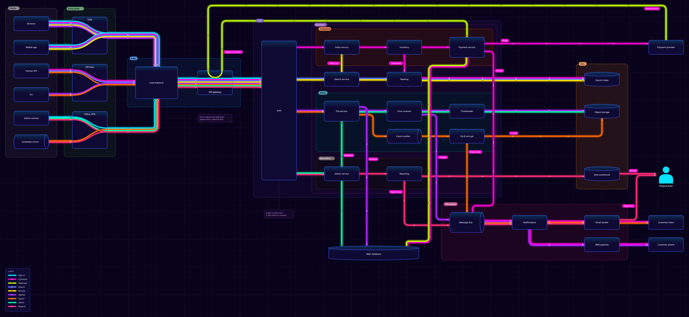
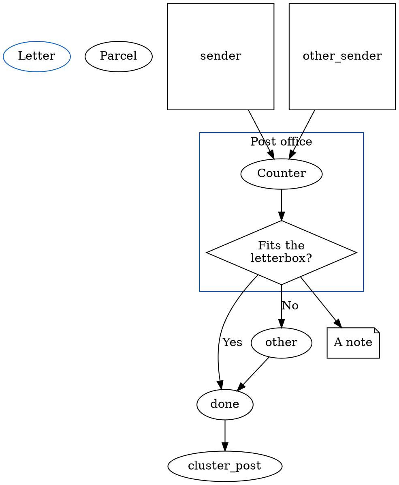
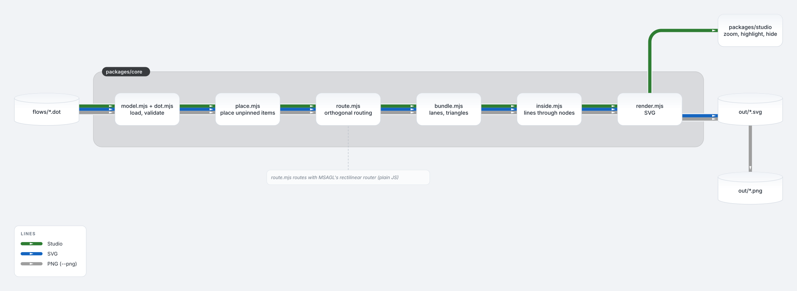

#  linemap

linemap draws flowcharts as metro maps. Each dataflow through your system is a coloured line that
runs from box to box, merging, splitting and crossing like lines on a transit map. You write the
flowchart in a DOT file, pin the boxes you care about, and linemap places the rest and draws the
lines. It is all plain text, so it diffs well, reviews well and works well with AI.

**[Try the examples in the studio](https://mergezalot.github.io/linemap/)**, in your browser, nothing to install.

linemap is young: 0.x releases may still change the DOT dialect.

## Features

### Flowcharts, shapes, nested containers, notes and through-view of nodes!

[](https://mergezalot.github.io/linemap/)

### Themeing, darkmode, micro animations (the `-fancy` themes), and all of that in SVG!

[](https://mergezalot.github.io/linemap/)

### Studio: single standalone html with everything embedded, including your dotfiles!

[](https://mergezalot.github.io/linemap/)

Click a picture to open the examples in the studio.

## Why not …

**[Mermaid](https://github.com/mermaid-js/mermaid)** is the quickest way to get a chart into a Markdown file, and GitHub renders it
inline. You cannot say where a box goes, though, and adding one node can move every other box.
Each edge is one arrow, so you cannot show a letter and a parcel taking the same road and
parting at the counter. In linemap you pin the boxes you care about, and each flow is its own
line.

**[Graphviz](https://graphviz.org).** linemap reads DOT, so `dot -Tsvg` still previews a linemap file. `dot` ignores
`pos` and places every box itself. `neato -n` keeps your positions but draws edges as splines;
with `splines=ortho` it drops ports and places labels poorly. Graphviz draws each edge on its
own and has no notion of a line that runs through several edges, so parallel flows come out as
separate arrows instead of a bundle.

**[PlantUML](https://github.com/plantuml/plantuml)** draws UML: sequence, class, state and activity diagrams. Graphviz (or its Java
port) lays out its component and deployment diagrams, so they cannot pin boxes or bundle lines
either. Pick PlantUML when you need UML notation.

**[draw.io](https://github.com/jgraph/drawio) and Miro** let you put every box and line exactly where you want. You also route every line by hand, and when you move a box you
fix its lines yourself. A Miro board lives in Miro, not in your repository. You can commit a
`.drawio` file, but it is compressed or verbose XML, which is hard to read in a diff and hard
for an AI to edit. In linemap you pin a box or add a `via` point where you care, and the router
places the rest.

**When to pick something else.** For a five-box sketch in a README, use Mermaid. For UML, use
PlantUML. Use linemap for a diagram of a system with several
flows that lives in your repository and changes in pull requests.

## Source format



- Graphviz scoping applies: `node [...]` and `edge [...]` set defaults for what follows in the
  same subgraph. A node belongs to the deepest cluster it is mentioned in.
- An edge may be written several times; its lines are merged.
- Shapes: `box` (default), `diamond`, `person`, `cylinder`, `queue`, `note`.
- `through=true` on a box, queue or cylinder joins the lines inside it, so they can merge,
  split and cross there. A line that only arrives or only leaves ends in a bar.
- Attributes. Graph: `label`, `theme`, `legend`/`legendpos` (where the legend goes),
  `diagonals=true` (experimental: lines may also run at 45°). Node:
  `label`, `shape`, `pos`, `width`, `height`, `through`, `class`, `URL`/`href`, `color`,
  `fillcolor`, `fontcolor`, `fontsize`. Cluster: `label` (`""`: no title), `class`, `color`, `fillcolor`,
  `fontcolor`, `fontsize`. Line: `label`, `color`. Edge: `label`, `lines`, `via`.
  Graphviz-only attributes are ignored; unknown ones are errors.
- Units follow Graphviz (inches, points) except `pos`, which is px with y down.
- Colours are hex, `#rgb` or `#rrggbb`; named colours like `red` are errors.
- `URL`/`href` must be `http://`, `https://`, `mailto:` or relative.
- A note's label may be HTML-like, as in Graphviz: `label=<Mind the <b>gap</b><br/>and the
  <font color="#c62828">step</font>>`. Supported: `<b>`, `<i>`, `<u>`, `<s>`, `<br/>`,
  `<font color="#…">`; any other tag (tables, images, …) is an error naming it. Elsewhere an
  HTML-like label shows as plain text.
- `dot -Tsvg flow.dot` still gives a Graphviz preview of the structure.

## Themes

Five themes: `minimal` (default), `light`, `dark`, `neon` and `neond` (neon on dark). They are
kept cheap to draw; each has a `-fancy` variant (`minimal-fancy`, `light-fancy`, …) that adds soft
shadows, glows and arrows travelling along the lines, at a real cost in CPU when panning, zooming
or just keeping the map on screen. Set `theme="dark"` on the graph, pass `--theme dark`, or switch
in the studio. `--css extra.css` restyles any `lm-*`
class on top.

## Running

Needs Node 22 or later.

```sh
npx @linemap/cli export flow.dot                      # -> flow.svg
npx @linemap/cli export flow.dot -o map.svg [--positions] [--legend show|hide]
            [--theme minimal|light|dark|neon|neond[-fancy]] [--css extra.css] [--notes show|hide]
npx @linemap/cli export flow.dot -o flow.html         # the studio with the flow baked in
npx @linemap/cli export a.dot b.dot -o flows.html     # several, picked on the start screen
npx @linemap/cli export                               # the empty studio: linemap.html
npx @linemap/cli studio [dir] [--port 8000] [--open]  # serve the DOT files under dir; the map follows saves
```

`export` writes what the output's extension says: `.svg` is the static map, `.html` is the
[studio](#studio) as one self-contained file, which works offline, from `file://`, and as an
embed in pages that cannot fetch files (e.g. Notion). `--positions` prints the computed positions as `name [pos="x,y"]`, ready to paste into the file.
`--notes hide` draws the map as if the notes were not there, so boxes and lines may take their
room. `--theme`, `--css`, `--legend`, `--positions` and `--notes` are for SVG. `linemap --help` lists the options. Exit codes: 0 done, 1 the file could not be drawn, 2 wrong
usage. Errors are one line; `LINEMAP_DEBUG=1` prints the stack instead.

To get a PNG, convert the SVG, e.g. `resvg out.svg out.png` or `rsvg-convert`. The text uses
Inter where it is installed, otherwise the next font in the list.

The library is `@linemap/core` (DOT text in, SVG string out; runs in Node and the browser);
the studio page is `@linemap/studio`.

## Development

Needs pnpm as well.

```sh
git clone https://github.com/mergezalot/linemap.git && cd linemap
pnpm install       # also bundles MSAGL into packages/core/vendor/
pnpm example       # redraws examples/*.svg, docs/pipeline.svg and the studio screenshot docs/studio.png
pnpm export [flow.dot ...] [-o out.svg|out.html] [options]   # linemap export, from the sources
pnpm studio [dir] [--port n] [--open]   # linemap studio, the page rebuilt when its sources change
pnpm build         # the studio page, packages/studio/dist/linemap.html, which export fills
pnpm test          # builds the studio, then core and CLI (node:test): errors, rendering, the committed SVGs, the CLI
pnpm test:studio   # the studio in headless Chromium (see below)
pnpm pack-check    # packs the npm packages, installs them in an empty folder, runs npx @linemap/cli
```

If a test says an example no longer matches its SVG, run `pnpm example` and
look at the result.

To release, run `pnpm release patch|minor|major|<x.y.z>`: it sets the same `version` in
`packages/core`, `packages/studio` and `packages/cli`, commits, and pushes a tag `v<version>`
(`scripts/release.sh`, plain bash with git, sed and grep; it releases only a clean `master` that
matches `origin/master`). The
Release workflow tests, packs and publishes the packages to npm (a version already on npm is
skipped). The tag's message lists the commit subjects since the previous release, and the workflow
posts them as the GitHub release notes.

## Studio

One self-contained HTML file that runs the whole pipeline in the browser. A build with the
examples baked in is at **https://mergezalot.github.io/linemap/**, published from `master` by `.github/workflows/pages.yml`.

```sh
pnpm studio                     # serves http://localhost:8000/studio.html#src=examples/postal.dot
pnpm export a.dot b.dot -o flows.html   # bakes flows into the page, e.g. for Notion
```

Open a file from the menu under its name (or `Ctrl+O`), by dropping it on the page, by pasting DOT text, or with `#src=` in the address, also in a page with flows baked in; there, a flow you pick is kept in the address too (`#src=flow.dot`), so a reload or a shared link shows it.
A file the studio serves (as under `linemap studio`) is redrawn on every save; switch that off with Follow saves in the file menu. The legend hides and solos lines; the toolbar switches lines
through nodes, 4 or 8 directions (experimental) and the theme without moving any box. **Notes** off (or `N`) draws the map
without the notes, like `--notes hide`, and puts a badge for each in its node: hover it to read
the note, click it to keep the note open beside it, click again (or press `Esc`) to close it.
The studio remembers notes on or off for your next visit. **Edit** (or `E`) changes the map in
place: drag boxes, bend lines, add, connect, reattach and delete boxes and edges, then undo with
`Ctrl Z`. Click a selected box again to resize it, a selected edge again to work on the one line
you clicked instead of the whole bundle. Shift+click, Shift+drag or a click on a container
selects several boxes, to move together, align or distribute evenly (Align), or to group them in a new container, merge their
containers, split them off into a new one, or ungroup a container. A note's text may use `<b>`,
`<i>`, `<u>`, `<s>` and `<font color>`. In edit mode the DOT text is beside the map: type in it and the map follows after a short pause (each pause one undo step, saved like a
map edit); a text that cannot be drawn keeps the last map and marks the line in error. Under `linemap studio` each edit is saved to the DOT file, changing only the lines it
must; elsewhere download the edited DOT file (above the source), or the page with it baked in. The SVG download is the map as shown:
hidden lines, through, theme and notes left out. The address keeps these settings and the view,
so a link reopens the same map (a `notes=` in it wins over the remembered one). Press `?` for keys.

Smoke test (headless Chromium): `pnpm --filter @linemap/studio exec playwright install chromium`
once, then `pnpm test:studio`.

## Design notes



- **Stages.** Load, place, route, bundle, inside, render. Each adds to one model and none moves
  what an earlier one placed, so hiding lines or switching themes reruns cheaply.
- **One connector per bundle.** The router sees one connection per node pair; `bundle.mjs`
  splits it into lanes. Lane order is the order of `subgraph lines`, the same for every edge.
- **Routing is MSAGL's.** `route.mjs` decides where each edge ends and hands one request to
  `msagl.mjs`, which runs Microsoft's rectilinear router and its nudger.
- **Placement is MSAGL's layered layout**, top to bottom, containers included. With nothing
  pinned it is used as it is. With pins, it is scaled and shifted to fit them, and each unpinned
  item takes the nearest free spot to where it would go, scored by distance, edge crossings and
  container borders. Notes sit beside their node. The CLI warns when a pinned node touches a container.
- **Containers grow around their members.** The router treats them as obstacles holding their
  members, so routes stay out of containers they have no business in. An edge to a container
  ends on its border, level with the other end where the side allows.
- **`via` points** split an edge into a chain of routes joined end to end.
- **Edge labels** are placed by MSAGL beside their bundle, near the start of the edge, where they
  cover no other label, box or line if there is such a spot.

Limits:

- Text widths are estimated (0.56 × font size per character), not measured.
- Routing is orthogonal, or with `diagonals=true` orthogonal with corners cut at 45°: not a
  true 8-direction router.
- Lines go through boxes, queues and cylinders only, not diamonds.

## License

[Mozilla Public License 2.0](LICENSE), © 2026 Michael Karlen. Use linemap in anything, open or
closed; if you ship changes to linemap's own files, publish those files under the MPL too.
Third-party code keeps its own license:

- MSAGL (`@msagl/core`, MIT, Microsoft) is a dependency, patched for an obstacle bug
  (`patches/`). `pnpm install` bundles the parts linemap uses into `packages/core/vendor/msagl.mjs`
  (not in git), with the license texts of MSAGL and its dependencies at the top. The studio
  carries them too.
