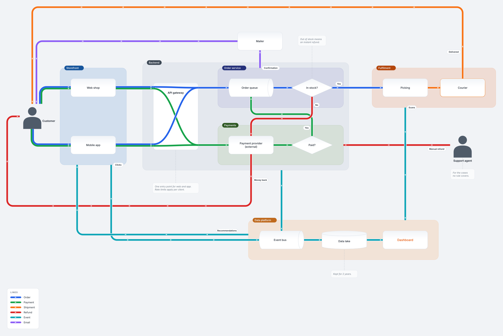
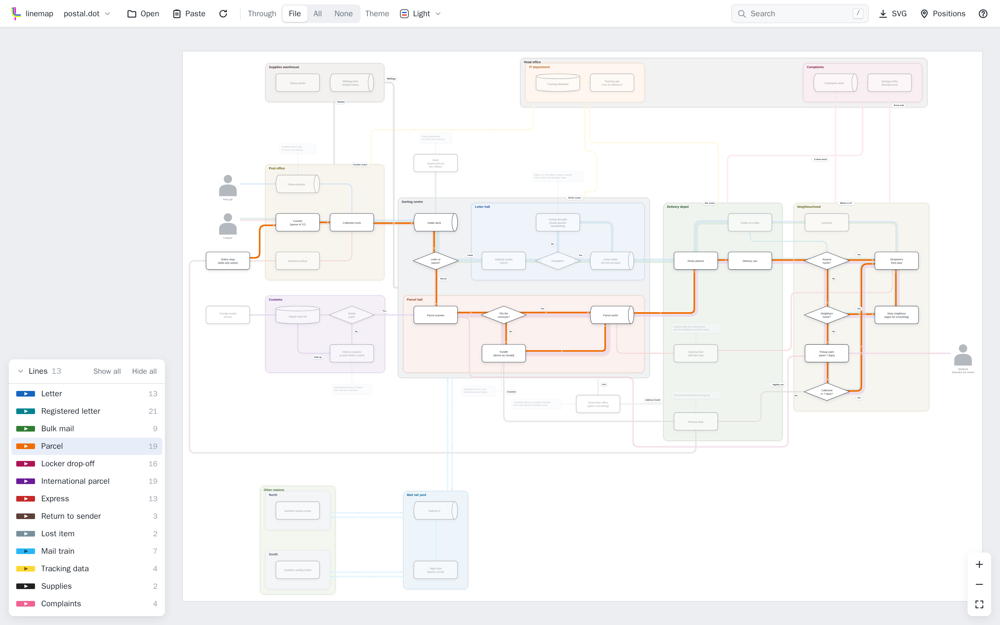
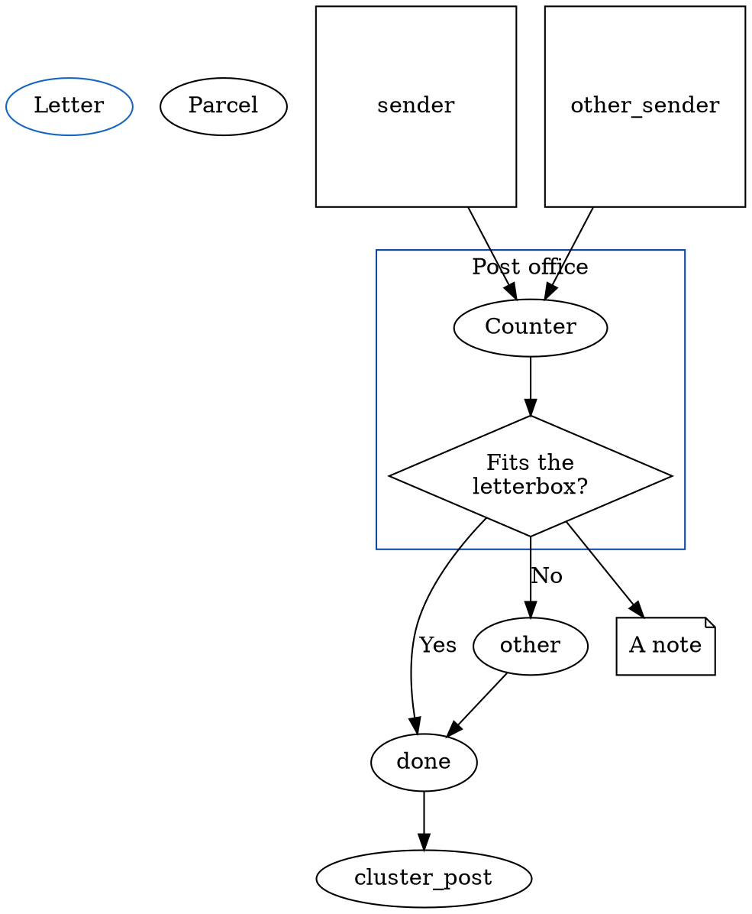

#  linemap

linemap draws flowcharts as metro maps. Each dataflow through your system is a coloured line that
runs from box to box, merging, splitting and crossing like lines on a transit map. You write the
flowchart in a DOT file, pin the boxes you care about, and linemap places the rest and draws the
lines. It is all plain text, so it diffs well, reviews well and works well with AI.

**[Try the examples in the studio](https://mergezalot.github.io/linemap/)**, in your browser, nothing to install.

linemap is young: 0.x releases may still change the DOT dialect.

## Features

### Flowcharts, shapes, nested containers, notes and through-view of nodes!

[](https://mergezalot.github.io/linemap/)

### Themeing, darkmode, micro animations (the `-fancy` themes), and all of that in SVG!

[](https://mergezalot.github.io/linemap/)

### Studio: single standalone html with everything embedded, including your dotfiles!

The studio is one self-contained HTML file that runs the whole pipeline in the browser: open a
DOT file, hide and solo lines, switch themes, read the notes, and edit the map in place, with each
edit saved back to the DOT file under `linemap studio`. Try it at
**https://mergezalot.github.io/linemap/**, or get it with `linemap export` or `linemap studio`
(see [Running](#running)). Press `?` in the studio for help and keys.

[](https://mergezalot.github.io/linemap/)

## Source format



- Graphviz scoping applies: `node [...]` and `edge [...]` set defaults for what follows in the
  same subgraph. A node belongs to the deepest cluster it is mentioned in.
- An edge may be written several times; its lines are merged.
- Shapes: `box` (default), `diamond`, `person`, `cylinder`, `queue`, `note`.
- `through=true` on a box, queue or cylinder joins the lines inside it, so they can merge,
  split and cross there. A line that only arrives or only leaves ends in a bar.
- Attributes. Graph: `label`, `theme`, `legend`/`legendpos` (where the legend goes). Node:
  `label`, `shape`, `pos`, `width`, `height`, `through`, `class`, `URL`/`href`, `color`,
  `fillcolor`, `fontcolor`, `fontsize`. Cluster: `label` (`""`: no title), `class`, `color`, `fillcolor`,
  `fontcolor`, `fontsize`. Line: `label`, `color`. Edge: `label`, `lines`, `via`.
  Graphviz-only attributes are ignored; unknown ones are errors.
- Units follow Graphviz (inches, points) except `pos`, which is px with y down.
- Colours are hex, `#rgb` or `#rrggbb`; named colours like `red` are errors.
- `URL`/`href` must be `http://`, `https://`, `mailto:` or relative.
- A note's label may be HTML-like, as in Graphviz: `label=<Mind the <b>gap</b><br/>and the
  <font color="#c62828">step</font>>`. Supported: `<b>`, `<i>`, `<u>`, `<s>`, `<br/>`,
  `<font color="#…">`; any other tag (tables, images, …) is an error naming it. Elsewhere an
  HTML-like label shows as plain text.
- `dot -Tsvg flow.dot` still gives a Graphviz preview of the structure.

## Running

Needs Node 22 or later.

```sh
npx @linemap/cli export flow.dot                      # -> flow.svg
npx @linemap/cli export flow.dot -o map.svg [--positions] [--legend show|hide]
            [--theme minimal|light|dark|neon|neond[-fancy]] [--css extra.css] [--notes show|hide]
npx @linemap/cli export flow.dot -o flow.html         # the studio with the flow baked in
npx @linemap/cli export a.dot b.dot -o flows.html     # several, picked on the start screen
npx @linemap/cli export                               # the empty studio: linemap.html
npx @linemap/cli studio [dir] [--port 8000] [--open]  # serve the DOT files under dir; the map follows saves
```

`export` writes what the output's extension says: `.svg` is the static map, `.html` is the
studio as one self-contained file, which works offline, from `file://`, and as an
embed in pages that cannot fetch files (e.g. Notion). `--positions` prints the computed positions as `name [pos="x,y"]`, ready to paste into the file.
`--notes hide` draws the map as if the notes were not there, so boxes and lines may take their
room. `--theme`, `--css`, `--legend`, `--positions` and `--notes` are for SVG. `linemap --help` lists the options. Exit codes: 0 done, 1 the file could not be drawn, 2 wrong
usage. Errors are one line; `LINEMAP_DEBUG=1` prints the stack instead.

To get a PNG, convert the SVG, e.g. `resvg out.svg out.png` or `rsvg-convert`. The text uses
Inter where it is installed, otherwise the next font in the list.

The library is `@linemap/core` (DOT text in, SVG string out; runs in Node and the browser);
the studio page is `@linemap/studio`.

## Why not …

**[Mermaid](https://github.com/mermaid-js/mermaid)** is the quickest way to get a chart into a Markdown file, and GitHub renders it
inline. You cannot say where a box goes, though, and adding one node can move every other box.
Each edge is one arrow, so you cannot show a letter and a parcel taking the same road and
parting at the counter. In linemap you pin the boxes you care about, and each flow is its own
line.

**[Graphviz](https://graphviz.org).** linemap reads DOT, so `dot -Tsvg` still previews a linemap file. `dot` ignores
`pos` and places every box itself. `neato -n` keeps your positions but draws edges as splines;
with `splines=ortho` it drops ports and places labels poorly. Graphviz draws each edge on its
own and has no notion of a line that runs through several edges, so parallel flows come out as
separate arrows instead of a bundle.

**[PlantUML](https://github.com/plantuml/plantuml)** draws UML: sequence, class, state and activity diagrams. Graphviz (or its Java
port) lays out its component and deployment diagrams, so they cannot pin boxes or bundle lines
either. Pick PlantUML when you need UML notation.

**[draw.io](https://github.com/jgraph/drawio) and Miro** let you put every box and line exactly where you want. You also route every line by hand, and when you move a box you
fix its lines yourself. A Miro board lives in Miro, not in your repository. You can commit a
`.drawio` file, but it is compressed or verbose XML, which is hard to read in a diff and hard
for an AI to edit. In linemap you pin a box or add a `via` point where you care, and the router
places the rest.

**When to pick something else.** For a five-box sketch in a README, use Mermaid. For UML, use
PlantUML. Use linemap for a diagram of a system with several
flows that lives in your repository and changes in pull requests.

Working on linemap itself: see [DEVELOPMENT.md](DEVELOPMENT.md).

## License

[Mozilla Public License 2.0](LICENSE), © 2026 Michael Karlen. Use linemap in anything, open or
closed; if you ship changes to linemap's own files, publish those files under the MPL too.
Third-party code keeps its own license:

- MSAGL (`@msagl/core`, MIT, Microsoft) is a dependency, patched for an obstacle bug
  (`patches/`). `pnpm install` bundles the parts linemap uses into `packages/core/vendor/msagl.mjs`
  (not in git), with the license texts of MSAGL and its dependencies at the top. The studio
  carries them too.
