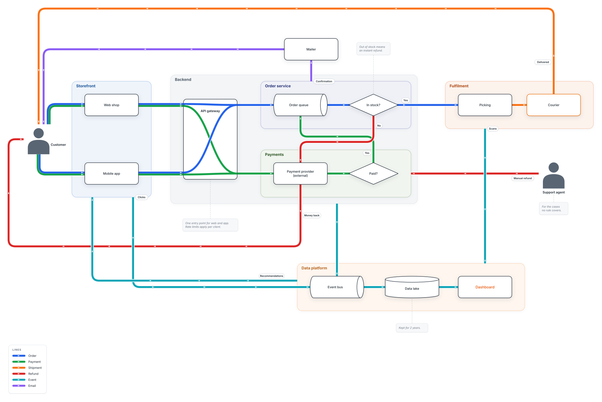
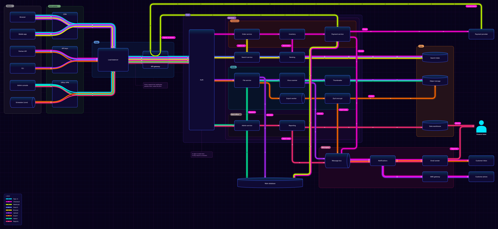
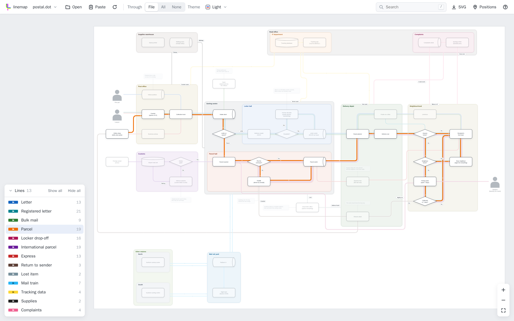
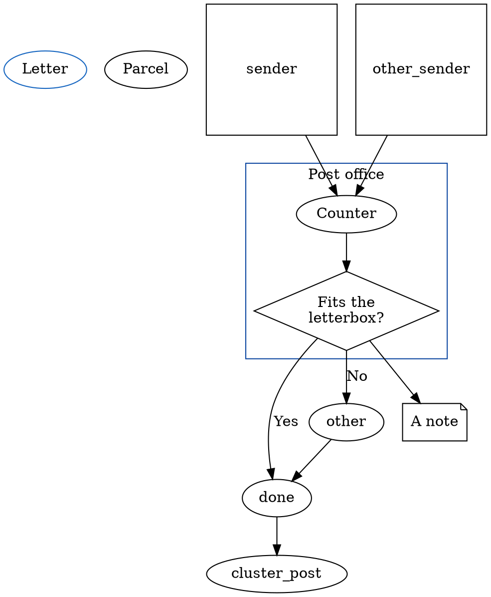
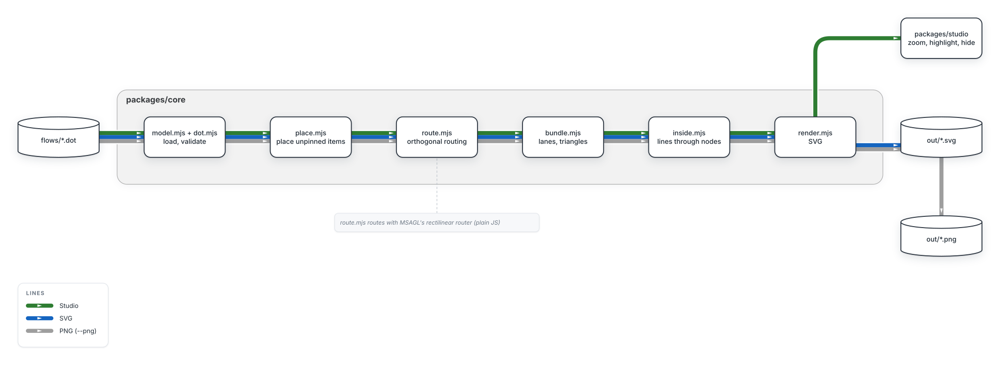

#  linemap

linemap draws flowcharts as metro maps. Each dataflow through your system is a coloured line that
runs from box to box, merging, splitting and crossing like lines on a transit map. You write the
flowchart in a DOT file, pin the boxes you care about, and linemap places the rest and draws the
lines. It is all plain text, so it diffs well, reviews well and works well with AI.

**[Try the examples in the studio](https://mergezalot.github.io/linemap/)**, in your browser, nothing to install.

linemap is young: 0.x releases may still change the DOT dialect.

## Features

### Flowcharts, shapes, nested containers, notes and through-view of nodes!

[](https://mergezalot.github.io/linemap/)

### Themeing, darkmode, micro animations, and all of that in SVG!

[](https://mergezalot.github.io/linemap/)

### Studio: single standalone html with everything embedded, including your dotfiles!

[](https://mergezalot.github.io/linemap/)

Click a picture to open the examples in the studio.

## Why not …

**[Mermaid](https://github.com/mermaid-js/mermaid)** is the quickest way to get a chart into a Markdown file, and GitHub renders it
inline. You cannot say where a box goes, though, and adding one node can move every other box.
Each edge is one arrow, so you cannot show a letter and a parcel taking the same road and
parting at the counter. In linemap you pin the boxes you care about, and each flow is its own
line.

**[Graphviz](https://graphviz.org).** linemap reads DOT, so `dot -Tsvg` still previews a linemap file. `dot` ignores
`pos` and places every box itself. `neato -n` keeps your positions but draws edges as splines;
with `splines=ortho` it drops ports and places labels poorly. Graphviz draws each edge on its
own and has no notion of a line that runs through several edges, so parallel flows come out as
separate arrows instead of a bundle.

**[PlantUML](https://github.com/plantuml/plantuml)** draws UML: sequence, class, state and activity diagrams. Graphviz (or its Java
port) lays out its component and deployment diagrams, so they cannot pin boxes or bundle lines
either. Pick PlantUML when you need UML notation.

**[draw.io](https://github.com/jgraph/drawio) and Miro** let you put every box and line exactly where you want. You also route every line by hand, and when you move a box you
fix its lines yourself. A Miro board lives in Miro, not in your repository. You can commit a
`.drawio` file, but it is compressed or verbose XML, which is hard to read in a diff and hard
for an AI to edit. In linemap you pin a box or add a `via` point where you care, and the router
places the rest.

**When to pick something else.** For a five-box sketch in a README, use Mermaid. For UML, use
PlantUML. Use linemap for a diagram of a system with several
flows that lives in your repository and changes in pull requests.

## Source format



- Graphviz scoping applies: `node [...]` and `edge [...]` set defaults for what follows in the
  same subgraph. A node belongs to the deepest cluster it is mentioned in.
- An edge may be written several times; its lines are merged.
- Shapes: `box` (default), `diamond`, `person`, `cylinder`, `queue`, `note`.
- `through=true` on a box, queue or cylinder joins the lines inside it, so they can merge,
  split and cross there. A line that only arrives or only leaves ends in a bar.
- Attributes. Graph: `label`, `theme`. Node: `label`, `shape`, `pos`, `width`, `height`,
  `through`, `class`, `URL`/`href`, `color`, `fillcolor`, `fontcolor`, `fontsize`. Cluster:
  `label`, `class`, `color`, `fillcolor`, `fontcolor`, `fontsize`. Line: `label`, `color`.
  Edge: `label`, `lines`, `via`. Graphviz-only attributes are ignored; unknown ones are errors.
- Units follow Graphviz (inches, points) except `pos`, which is px with y down.
- Colours are hex, `#rgb` or `#rrggbb`; named colours like `red` are errors.
- `URL`/`href` must be `http://`, `https://`, `mailto:` or relative.
- `dot -Tsvg flow.dot` still gives a Graphviz preview of the structure.

## Themes

Five themes: `light` (default), `dark`, `minimal`, `neon` and `neond` (neon on dark). Set `theme="dark"` on
the graph, pass `--theme dark`, or switch in the studio. `--css extra.css` restyles any `lm-*`
class on top.

## Running

Needs Node 22 or later.

```sh
npx linemap <flow.dot> <out.svg> [--positions]
            [--theme light|dark|minimal|neon|neond] [--css extra.css]
```

`--positions` prints the computed positions as `name [pos="x,y"]`, ready to paste into the file.
`linemap --help` lists the options. Exit codes: 0 done, 1 the file could not be drawn, 2 wrong
usage. Errors are one line; `LINEMAP_DEBUG=1` prints the stack instead.

To get a PNG, convert the SVG, e.g. `resvg out.svg out.png` or `rsvg-convert`. The text uses
Inter where it is installed, otherwise the next font in the list.

The library is `@linemap/core` (DOT text in, SVG string out; runs in Node and the browser).

## Development

Needs pnpm as well.

```sh
git clone https://github.com/mergezalot/linemap.git && cd linemap
pnpm install       # also bundles MSAGL into packages/core/vendor/
pnpm example       # redraws examples/*.svg, docs/pipeline.svg and the studio screenshot docs/studio.png
pnpm linemap <flow.dot> <out.svg> [options]
pnpm test          # core and CLI (node:test): errors, rendering, the committed SVGs, the CLI
pnpm test:studio   # the studio in headless Chromium (see below)
pnpm pack-check    # packs both npm packages, installs them in an empty folder, runs npx linemap
```

If a test says an example no longer matches its SVG, run `pnpm example` and
look at the result.

To release, set the same `version` in `packages/core` and `packages/cli`, commit, and push a tag
`v<version>`. The Release workflow tests, packs and publishes both packages to npm (a version
already on npm is skipped).

## Studio

One self-contained HTML file that runs the whole pipeline in the browser. A build with the
examples baked in is at **https://mergezalot.github.io/linemap/**, published from `master` by `.github/workflows/pages.yml`.

```sh
pnpm studio                     # -> packages/studio/dist/linemap-studio.html
pnpm studio:serve               # serves http://localhost:8000/studio.html?src=examples/postal.dot
pnpm studio --embed a.dot b.dot # bakes flows into the file, e.g. for Notion
```

Open a file with the toolbar, by dropping it on the page, by pasting DOT text, or with `?src=`.
**Watch** redraws on every save. The legend hides and solos lines; the toolbar switches lines
through nodes and the theme, without moving any box. The address keeps these
settings and the view, so a link reopens the same map. Press `?` for keys.

Smoke test (headless Chromium): `pnpm --filter @linemap/studio exec playwright install chromium`
once, then `pnpm test:studio`.

## Design notes



- **Stages.** Load, place, route, bundle, inside, render. Each adds to one model and none moves
  what an earlier one placed, so hiding lines or switching themes reruns cheaply.
- **One connector per bundle.** The router sees one connection per node pair; `bundle.mjs`
  splits it into lanes. Lane order is the order of `subgraph lines`, the same for every edge.
- **Routing is MSAGL's.** `route.mjs` decides where each edge ends and hands one request to
  `msagl.mjs`, which runs Microsoft's rectilinear router and its nudger.
- **Placement is MSAGL's layered layout**, top to bottom, containers included. With nothing
  pinned it is used as it is. With pins, it is scaled and shifted to fit them, and each unpinned
  item takes the nearest free spot to where it would go, scored by distance, edge crossings and
  container borders. Notes sit beside their node. The CLI warns when a pinned node touches a container.
- **Containers grow around their members.** The router treats them as obstacles holding their
  members, so routes stay out of containers they have no business in. An edge to a container
  ends on its border, level with the other end where the side allows.
- **`via` points** split an edge into a chain of routes joined end to end.
- **Edge labels** are placed by MSAGL beside their bundle, near the start of the edge, where they
  cover no other label, box or line if there is such a spot.

Limits:

- Text widths are estimated (0.56 × font size per character), not measured.
- Routing is orthogonal only.
- Lines go through boxes, queues and cylinders only, not diamonds.
- The studio does not edit yet; positions go back into the DOT file by hand.

## License

[Mozilla Public License 2.0](LICENSE), © 2026 Michael Karlen. Use linemap in anything, open or
closed; if you ship changes to linemap's own files, publish those files under the MPL too.
Third-party code keeps its own license:

- MSAGL (`@msagl/core`, MIT, Microsoft) is a dependency, patched for an obstacle bug
  (`patches/`). `pnpm install` bundles the parts linemap uses into `packages/core/vendor/msagl.mjs`
  (not in git), with the license texts of MSAGL and its dependencies at the top. The studio
  carries them too.
