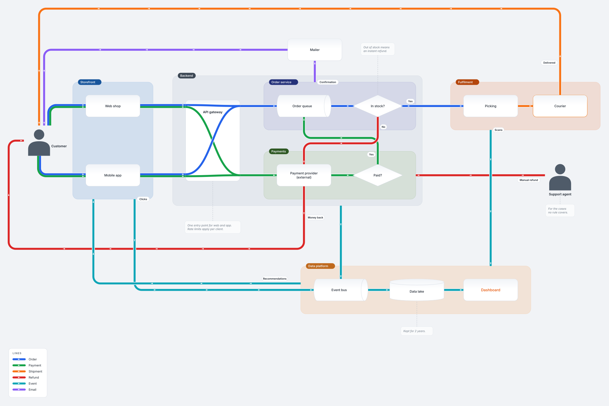

# linemap

Draw how data flows through a system like a subway map. Write the flow as a DOT file; pinned
boxes stay put, the rest is placed automatically, and the lines are routed orthogonally and
drawn as transit-map bundles.

[](https://mergezalot.github.io/linemap/)

**[Try the examples in the studio](https://mergezalot.github.io/linemap/)**, in your browser, nothing to install.

```sh
npx @linemap/cli export flow.dot                      # -> flow.svg
npx @linemap/cli export flow.dot -o map.svg [--positions] [--legend show|hide]
            [--theme minimal|light|dark|neon|neond[-fancy]] [--css extra.css] [--notes show|hide]
npx @linemap/cli export flow.dot -o flow.html         # the studio with the flow baked in
npx @linemap/cli export a.dot b.dot -o flows.html     # several, picked on the start screen
npx @linemap/cli export                               # the empty studio: linemap.html
npx @linemap/cli studio [dir] [--port 8000] [--open]  # serve the DOT files under dir, with Watch
```

Or install it once with `npm install -g @linemap/cli` and run `linemap` with the same arguments.

- `export` writes what the output's extension says: `.svg` is the static map, `.html` the
  studio as one self-contained file (works offline, from `file://`, and as an embed, e.g. in
  Notion). `--theme`, `--css`, `--legend`, `--positions` and `--notes` are for SVG.
- `studio` serves the studio and the DOT files under a folder on this machine; open one with
  `#src=<file>`, and **Watch** redraws it on every save.
- `--positions` prints the computed positions as `name [pos="x,y"]`, ready to paste into the file.
- `--css` adds a CSS file after the theme's, to restyle any `lm-*` class.
- `--notes hide` draws the map as if the notes were not there, so boxes and lines may take their room.
- `linemap --help` lists every option.
- Exit codes: 0 done, 1 the file could not be drawn, 2 wrong usage. `LINEMAP_DEBUG=1` prints
  stacks instead of one-line errors.

Needs Node 22 or later. The DOT format is described in the
[project README](https://github.com/mergezalot/linemap#source-format); the library is
[`@linemap/core`](https://www.npmjs.com/package/@linemap/core).

## License

[Mozilla Public License 2.0](https://github.com/mergezalot/linemap/blob/master/LICENSE)
