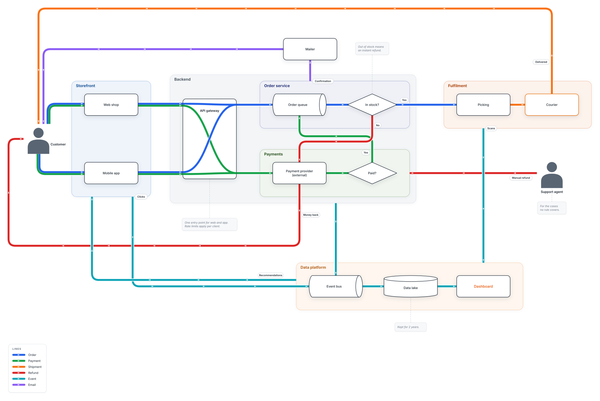

# linemap

Draw how data flows through a system like a subway map. Write the flow as a DOT file; pinned
boxes stay put, the rest is placed automatically, and the lines are routed orthogonally and
drawn as transit-map bundles.

[](https://mergezalot.github.io/linemap/)

**[Try the examples in the studio](https://mergezalot.github.io/linemap/)**, in your browser, nothing to install.

```sh
npx linemap <flow.dot> <out.svg> [--positions]
            [--theme light|dark|minimal|neon|neond] [--css extra.css]
```

- `--positions` prints the computed positions as `name [pos="x,y"]`, ready to paste into the file.
- `--css` adds a CSS file after the theme's, to restyle any `lm-*` class.
- Exit codes: 0 done, 1 the file could not be drawn, 2 wrong usage. `LINEMAP_DEBUG=1` prints
  stacks instead of one-line errors.

Needs Node 22 or later. The DOT format is described in the
[project README](https://github.com/mergezalot/linemap#source-format); the library is
[`@linemap/core`](https://www.npmjs.com/package/@linemap/core).

## License

[Mozilla Public License 2.0](https://github.com/mergezalot/linemap/blob/master/LICENSE)
