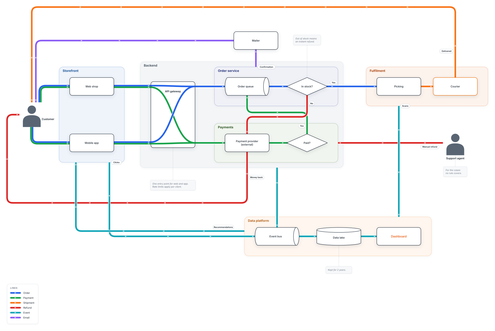

# @linemap/core

Draw how data flows through a system like a subway map. DOT text in, SVG string out: pinned
boxes stay put, the rest is placed automatically, and the lines are routed orthogonally and
drawn as transit-map bundles. No I/O; runs in Node 22+ and the browser.

[](https://mergezalot.github.io/linemap/)

```js
import { parseFlow, layout, render } from '@linemap/core';

const svg = render(layout(parseFlow(dotText)), { theme: 'dark' });
```

- `parseFlow(text)` reads a linemap DOT file into a model; errors are thrown with one-line messages.
- `layout(model, { hiddenLines, through, fixed })` places, routes and bundles it. Call it once
  per parsed model.
- `render(model, { theme, css })` returns the SVG. Themes: `light`, `dark`, `minimal`, `neon`, `neond`.
- `positions(model)` gives the computed positions of unpinned nodes, ready to pin with `pos`.

The command line is [`@linemap/cli`](https://www.npmjs.com/package/@linemap/cli): `npx @linemap/cli flow.dot out.svg`.
The DOT format, themes and the studio are described in the
[project README](https://github.com/mergezalot/linemap#readme).

Placement and routing use Microsoft's [MSAGL](https://github.com/microsoft/msagl-js) (MIT),
bundled in `vendor/`.

## License

[Mozilla Public License 2.0](https://github.com/mergezalot/linemap/blob/master/LICENSE)
